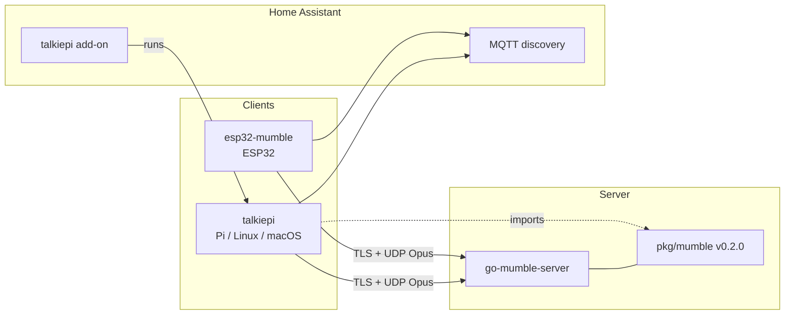

# Ecosystem

talkiepi is one of three sibling projects that share a Mumble protocol stack, voice conventions, and Home Assistant / UI patterns.

| Project | Role |
|---------|------|
| [go-mumble-server](https://github.com/dchote/go-mumble-server) | Go Mumble **server** and the canonical `pkg/mumble` protocol library |
| [esp32-mumble](https://github.com/dchote/esp32-mumble) | ESP32 / ESPHome **hardware client** |
| **talkiepi** | Raspberry Pi / Linux / macOS **client** with embedded web UI and HA add-on |

talkiepi is **not** a barnard / gumble / OpenAL fork. It is a next-generation client that imports `github.com/dchote/go-mumble-server/pkg/mumble` (pinned at **v0.2.0**) and aligns behavior with esp32-mumble.

## What each owns

| Concern | Owner |
|---------|--------|
| Wire protocol, crypto modes, server semantics | go-mumble-server (`pkg/mumble` + docs) |
| Server admin UI, virtual servers, ACLs | go-mumble-server |
| ESP32 capture, I2S, ESPHome config, HA entities | esp32-mumble |
| Communicator half-duplex state machine (reference) | esp32-mumble (talkiepi mirrors) |
| VAD / voice timing constants (reference) | esp32-mumble (talkiepi mirrors) |
| Pi / desktop audio (ALSA, Pulse, CoreAudio), SpeexDSP AEC | talkiepi |
| GPIO PTT / status LEDs, Debian package, HA add-on ingress | talkiepi |
| Embedded Vue management UI (client) | talkiepi (same Vuetify rules as server UI) |

## Shared conventions

- **Protocol** — TLS control channel + optional encrypted UDP voice; Opus preferred; crypto modes `legacy` and `lite` (see go-mumble-server protocol docs).
- **Voice** — 20 ms frames; talkiepi defaults to 48 kHz / 40 kbps; esp32-mumble uses 16 kHz / 16 kbps (talkiepi exposes an Esp32-compatible profile).
- **Communicator mode** — Half-duplex channel with open/close chimes and a silence timeout before closing (same state names as esp32-mumble).
- **Home Assistant** — Numbered MQTT discovery config entities (`1. Server` … `7. Crypto`), PTT / Communicator buttons, connection and voice sensors.
- **UI** — Vue 3 + Vuetify 3, StandardCard patterns, no `gap`, `mr-2` between buttons, outlined compact inputs (see [patterns](patterns/)).

## Interop

Any standards-compliant Mumble server works; go-mumble-server is the reference implementation and library source for this family.

## Documentation map

| Doc | Content |
|-----|---------|
| [product-overview.md](product-overview.md) | Vision, features, packaging |
| [technical-overview.md](technical-overview.md) | Stack and architecture |
| [build-and-test.md](build-and-test.md) | Local build, CGO, deb |
| [architecture/](architecture/) | Client and audio pipeline detail |
| [protocol/handshake.md](protocol/handshake.md) | Client deltas only |
| [deployment/](deployment/) | Debian, HA add-on, macOS |
| [hardware/](hardware/) | Audio devices, GPIO wiring |
