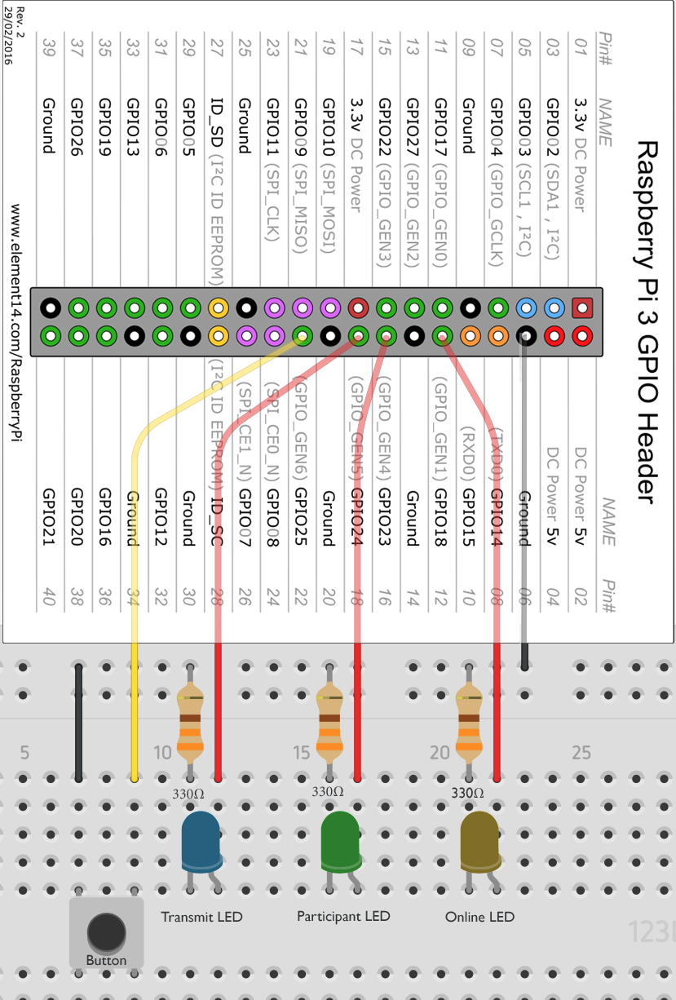

# GPIO wiring

Hardware PTT and status LEDs target Raspberry Pi–class boards using Linux `gpiochip` character devices (`/dev/gpiochip0`, etc.).

Reference diagram: 

Assembled references: [`hardware/talkiepi_assembled_1.jpg`](../../hardware/talkiepi_assembled_1.jpg), [`hardware/talkiepi_assembled_2.jpg`](../../hardware/talkiepi_assembled_2.jpg). Case STLs live under [`hardware/stl/`](../../hardware/stl/).

## PTT button

Config (`triggers` / add-on options):

| Key | Meaning |
|-----|---------|
| `gpio_chip` | Chip name/path (e.g. `gpiochip0`) |
| `gpio_line` | Line offset |
| `active_low` | `true` when the switch pulls the line to ground (default) |

Wire a momentary switch between the GPIO line and GND when `active_low: true` (internal pull-up assumed by the driver configuration). Debounce is handled in software via the PTT mux edge handling.

Empty `gpio_chip` disables hardware PTT (REST/MQTT still work).

## Status LEDs

Config (`leds`):

| Key | Default line | Meaning |
|-----|--------------|---------|
| `online_line` | 18 | Connected to Mumble |
| `participants_line` | 23 | Other users in channel |
| `transmit_line` | 24 | Locally transmitting |

Enable with `leds.enabled: true` and set `leds.chip` (e.g. `gpiochip0`). Drive LEDs with appropriate series resistors from 3.3 V GPIO.

Match the silkscreen / diagram in `hardware/gpio_diagram.png` when using the official talkiepi PCB/case.

## Permissions

- Debian package: service user is in groups `audio` and `gpio`.
- Add-on: `/dev/gpiochip0` is mapped in `addon/config.yaml`.
- Dev on Pi: ensure the process can open the chip (`dialout`/`gpio` group or udev rules).

## Non-Linux

GPIO backends are stubbed on non-Linux builds. Use REST `/api/v1/ptt` or the web UI for PTT on macOS.
